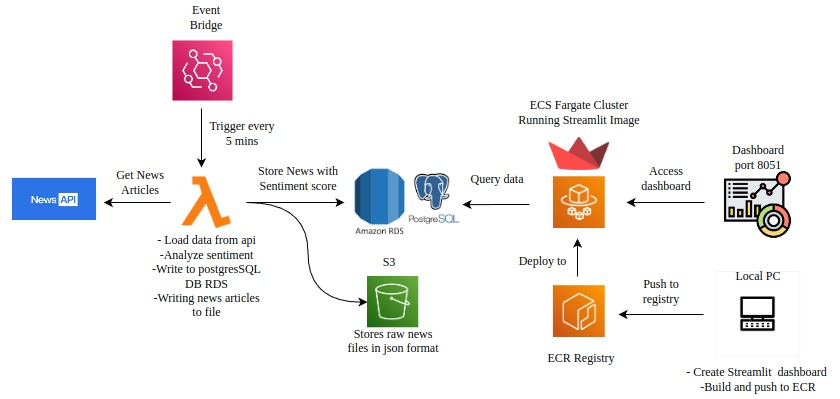

# 📰 Real-Time News Sentiment Analysis using AWS

A cloud-based **near-real-time news sentiment analysis pipeline** that automatically collects technology news, analyzes sentiment using Python and VADER, stores raw and processed data, and displays the results through a Streamlit dashboard hosted on AWS.

---

## 📌 Project Overview

This project demonstrates how multiple AWS services can be integrated to build an automated data processing and visualization pipeline.

The system automatically runs every **5 minutes**, collects the latest technology news from the **GNews API**, performs sentiment analysis using **VADER**, stores the raw news in **Amazon S3**, stores processed articles in **Amazon RDS PostgreSQL**, and displays the results through a **Streamlit dashboard running on Amazon ECS Fargate**.

### 🔄 Architecture

```text
                    ┌─────────────────────┐
                    │ EventBridge Scheduler│
                    │     Every 5 Minutes  │
                    └──────────┬──────────┘
                               │
                               ▼
                    ┌─────────────────────┐
                    │    AWS Lambda       │
                    │  Container Image    │
                    └──────────┬──────────┘
                               │
                               ▼
                    ┌─────────────────────┐
                    │     GNews API       │
                    │  Technology News    │
                    └──────────┬──────────┘
                               │
                               ▼
                    ┌─────────────────────┐
                    │ Python Processing   │
                    │ + VADER Sentiment   │
                    └──────────┬──────────┘
                               │
                    ┌──────────┴──────────┐
                    ▼                     ▼
          ┌─────────────────┐   ┌────────────────────┐
          │   Amazon S3     │   │ Amazon RDS          │
          │   Raw JSON Data │   │ PostgreSQL          │
          └─────────────────┘   └─────────┬──────────┘
                                          │
                                          ▼
                              ┌────────────────────────┐
                              │ Amazon ECS Fargate      │
                              │ Streamlit Dashboard     │
                              └────────────────────────┘
```

### Architecture Diagram



---

## 🚀 End-to-End Workflow

1. **EventBridge Scheduler** triggers the pipeline every 5 minutes.
2. **AWS Lambda** starts the news processing workflow.
3. Lambda calls the **GNews API** and retrieves technology-related news.
4. The raw API response is stored in **Amazon S3** as a JSON file.
5. Python processes each article.
6. **VADER Sentiment Analysis** calculates the sentiment score.
7. Each article is classified as:
   - 🟢 Positive
   - 🔴 Negative
   - ⚪ Neutral
8. Processed articles are stored in **Amazon RDS PostgreSQL**.
9. A **Streamlit dashboard** running on **Amazon ECS Fargate** reads the latest data from RDS.
10. The dashboard displays sentiment statistics and recent news articles.

---

## ☁️ AWS Services Used

| AWS Service                      | Purpose                                             |
| -------------------------------- | --------------------------------------------------- |
| **Amazon EventBridge Scheduler** | Automatically triggers the pipeline every 5 minutes |
| **AWS Lambda**                   | Executes the news processing pipeline               |
| **Amazon ECR**                   | Stores Docker container images                      |
| **Amazon S3**                    | Stores raw news JSON data                           |
| **Amazon RDS PostgreSQL**        | Stores processed news and sentiment data            |
| **Amazon ECS Fargate**           | Hosts the Streamlit dashboard                       |
| **AWS IAM**                      | Manages permissions and access                      |
| **Amazon CloudWatch**            | Stores Lambda/application logs                      |

---

## 🛠️ Technologies Used

- **Python 3.14**
- **VADER Sentiment Analysis**
- **GNews API**
- **PostgreSQL**
- **AWS**
- **Docker**
- **Amazon ECR**
- **AWS Lambda**
- **Amazon S3**
- **Amazon RDS**
- **Amazon ECS Fargate**
- **Amazon EventBridge**
- **Streamlit**
- **Git & GitHub**

---

## 🧠 Sentiment Analysis

The project uses the **VADER (Valence Aware Dictionary and sEntiment Reasoner)** sentiment analyzer.

The VADER compound score ranges from **-1 to +1**.

|             Compound Score | Sentiment |
| -------------------------: | --------- |
|                  `>= 0.05` | Positive  |
|                 `<= -0.05` | Negative  |
| Between `-0.05` and `0.05` | Neutral   |

The sentiment score is stored in PostgreSQL along with the article information.

---

## 🗄️ Database

The project uses **Amazon RDS PostgreSQL**.

### Database

```text
news_sentiment
```

### Main Table

```text
news_articles
```

The table stores information such as:

- Article ID
- Title
- Description
- Content
- URL
- Image
- Published date
- Language
- Source
- Sentiment
- Sentiment score

The article ID is used as the primary key, and duplicate articles are prevented using:

```sql
ON CONFLICT (id) DO NOTHING
```

---

## 🪣 Amazon S3

Raw GNews API responses are stored in Amazon S3.

Objects follow a structure similar to:

```text
raw-news/
└── YYYY/
    └── MM/
        └── DD/
            └── HHMMSS.json
```

This keeps the original API response available for future analysis or auditing.

---

## 🐳 Docker

Docker is used to containerize the application.

Two Docker images are used:

### Lambda

```text
news-sentiment-lambda
```

The Lambda container contains the Python news processing pipeline.

### Dashboard

```text
news-sentiment-dashboard
```

The dashboard container runs the Streamlit application on port:

```text
8501
```

---

## 📊 Streamlit Dashboard

The dashboard displays:

- Total number of articles
- Positive article count
- Negative article count
- Neutral article count
- Sentiment distribution
- Recent news articles
- Sentiment scores
- Source information
- Clickable article links

The dashboard is deployed using **Amazon ECS Fargate**.

---

## 📁 Project Structure

```text
news-sentiment-analysis/
│
├── dashboard/
│   ├── app.py
│   └── Dockerfile
│
├── src/
│   ├── database/
│   │   ├── connection.py
│   │   ├── insert_news.py
│   │   └── tables.py
│   │
│   ├── news/
│   │   ├── gnews.py
│   │   └── processor.py
│   │
│   ├── sentiment/
│   │   └── analyzer.py
│   │
│   ├── storage/
│   │   └── s3.py
│   │
│   ├── lambda_function.py
│   └── local_pipeline.py
│
├── Dockerfile
├── requirements.txt
├── .gitignore
└── README.md
```

---

## 🔐 Security

Sensitive information is **not stored in the GitHub repository**.

Environment variables are used for:

```text
GNEWS_API_KEY
DB_HOST
DB_PORT
DB_NAME
DB_USER
DB_PASSWORD
S3_BUCKET
```

The `.env` file is excluded using `.gitignore`.

AWS credentials and API keys should never be committed to GitHub.

---

## 🧪 Testing

The project was tested in stages:

1. GNews API connection
2. VADER sentiment analysis
3. PostgreSQL/RDS connection
4. S3 upload
5. Complete local pipeline
6. Lambda Docker container
7. AWS Lambda execution
8. Lambda → RDS connection
9. EventBridge → Lambda automation
10. Local Streamlit dashboard
11. ECS Fargate deployment
12. ECS → RDS connection
13. Complete end-to-end pipeline

---

## 📈 Project Result

The completed system can automatically:

**Collect → Process → Analyze → Store → Visualize**

technology news without manually running the pipeline every time.

The final workflow is:

```text
EventBridge
     ↓
AWS Lambda
     ↓
GNews API
     ↓
Python + VADER
     ↓
 ┌───────────┐
 ↓           ↓
S3          RDS
             ↓
        ECS Fargate
             ↓
     Streamlit Dashboard
```

---

## 🔮 Future Improvements

For a production environment, the architecture could be improved by:

- Moving RDS into a private subnet
- Removing public database access
- Using tighter security-group rules
- Adding HTTPS using an Application Load Balancer
- Adding authentication to the dashboard
- Using AWS Secrets Manager instead of plain environment variables
- Adding CI/CD with GitHub Actions
- Adding monitoring and alerting
- Implementing better scaling and fault tolerance

---

## 👨‍💻 Author

**Swalih Kamarudheen**

GitHub:
[https://github.com/Swalih-kamarudheen](https://github.com/Swalih-kamarudheen)

---

## ⭐ Project Summary

This project demonstrates practical experience with:

**Python • AWS • Docker • PostgreSQL • Lambda • S3 • RDS • ECS Fargate • EventBridge • ECR • Streamlit • Git • GitHub**

It combines **data ingestion, sentiment analysis, cloud computing, containerization, database management, automation, and data visualization** into a single end-to-end project.


## 🛠️ Project Implementation – Step-by-Step

This section documents the development and deployment process of the Real-Time News Sentiment Analysis project.

### Phase 1: Development Environment Setup

1. Installed Python 3.14.3.
2. Installed and configured Visual Studio Code.
3. Installed Git and configured the project repository.
4. Created a Python virtual environment using `venv`.
5. Installed the required Python libraries using `requirements.txt`.
6. Created the project folder structure and Python modules.

### Phase 2: News API Integration

7. Registered for the GNews API.
8. Configured the `GNEWS_API_KEY` environment variable.
9. Integrated the GNews API using Python Requests.
10. Retrieved technology-related news articles in JSON format.
11. Tested the API connection locally.

### Phase 3: Sentiment Analysis

12. Installed and configured the VADER sentiment analysis library.
13. Developed the sentiment analyzer module.
14. Implemented positive, negative and neutral sentiment classification.
15. Applied compound score thresholds:
    - Positive: compound score >= 0.05
    - Negative: compound score <= -0.05
    - Neutral: compound score between -0.05 and 0.05.
16. Developed the article processing module to extract news details and sentiment scores.

### Phase 4: PostgreSQL Database Setup

17. Created an Amazon RDS PostgreSQL database.
18. Configured database connectivity and security groups.
19. Created the `news_sentiment` database.
20. Created the `news_articles` table.
21. Developed Python database connection and insertion modules.
22. Implemented duplicate prevention using `ON CONFLICT (id) DO NOTHING`.
23. Tested database connectivity and article insertion.

### Phase 5: Amazon S3 Integration

24. Created an Amazon S3 bucket.
25. Configured IAM permissions for S3 uploads.
26. Developed the S3 storage module using Boto3.
27. Implemented raw news JSON uploads.
28. Tested successful storage of raw news data.

### Phase 6: Local Pipeline Integration

29. Integrated GNews API, sentiment analysis, S3 and PostgreSQL.
30. Developed the local pipeline execution module.
31. Executed the complete pipeline locally.
32. Verified that raw news was uploaded to S3 and processed articles were inserted into PostgreSQL.

### Phase 7: Docker Configuration

33. Installed and configured Docker Desktop.
34. Created the Lambda Dockerfile.
35. Created the dashboard Dockerfile.
36. Built the Lambda container image.
37. Built the Streamlit dashboard container image.
38. Tested both containers locally.

### Phase 8: AWS Lambda and ECR Deployment

39. Created the Lambda execution IAM role.
40. Configured CloudWatch logging and S3 upload permissions.
41. Created Amazon ECR repositories for Lambda and dashboard images.
42. Pushed the Docker images to Amazon ECR.
43. Created the AWS Lambda function using the container image.
44. Configured environment variables and Lambda timeout.
45. Tested the Lambda function and verified successful processing.

### Phase 9: EventBridge Scheduler and Monitoring

46. Created an EventBridge Scheduler.
47. Configured the schedule to run every five minutes.
48. Connected the scheduler to the Lambda function.
49. Enabled the scheduler.
50. Verified scheduled Lambda executions using Amazon CloudWatch Logs.

### Phase 10: Streamlit Dashboard Development

51. Developed an interactive Streamlit dashboard.
52. Connected the dashboard to Amazon RDS PostgreSQL.
53. Added total article, positive, negative and neutral metrics.
54. Added sentiment distribution visualization.
55. Added a recent news articles table with clickable article links.
56. Tested the dashboard locally.

### Phase 11: ECS Fargate Deployment

57. Created an Amazon ECS cluster.
58. Configured the Fargate task definition.
59. Configured the ECS task execution IAM role.
60. Registered the dashboard container image from ECR.
61. Configured container port 8501.
62. Created the ECS service.
63. Configured networking, security groups and public IP access.
64. Deployed the Streamlit dashboard on ECS Fargate.
65. Verified the dashboard through its public IP address.
66. Tested the dashboard's connection to the RDS database.

### Phase 12: Git and GitHub Integration

67. Initialized the local Git repository.
68. Created a `.gitignore` file to exclude sensitive and unnecessary files.
69. Committed the initial project files.
70. Created a GitHub repository.
71. Connected the local repository to GitHub.
72. Pushed the project to the `main` branch.
73. Added project documentation to `README.md`.
74. Added the architecture image to the repository.
75. Committed and pushed the documentation and image updates.

### Final Project Result

Successfully developed and deployed an AWS-based real-time news sentiment analysis pipeline.

The system automatically retrieves technology news every five minutes, analyzes article sentiment using VADER, stores raw data in Amazon S3, saves processed data in PostgreSQL on Amazon RDS, and displays the results through a Streamlit dashboard hosted on Amazon ECS Fargate.

**Project status:** Successfully deployed and tested.

**AWS Region:** Asia Pacific (Sydney) – `ap-southeast-2`

**Note:** This is an educational demonstration architecture. Public database access and broad inbound security-group rules should be replaced with private networking and restricted access before production use.